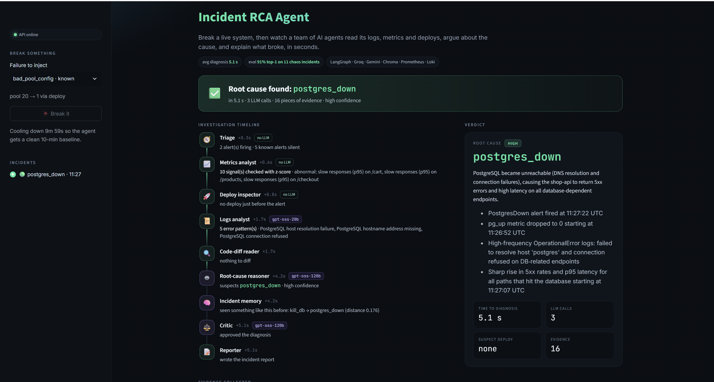
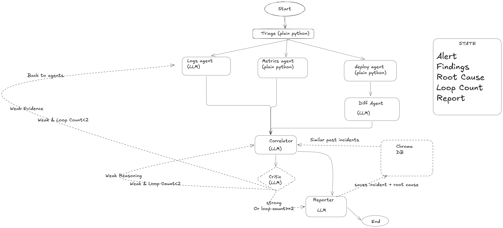
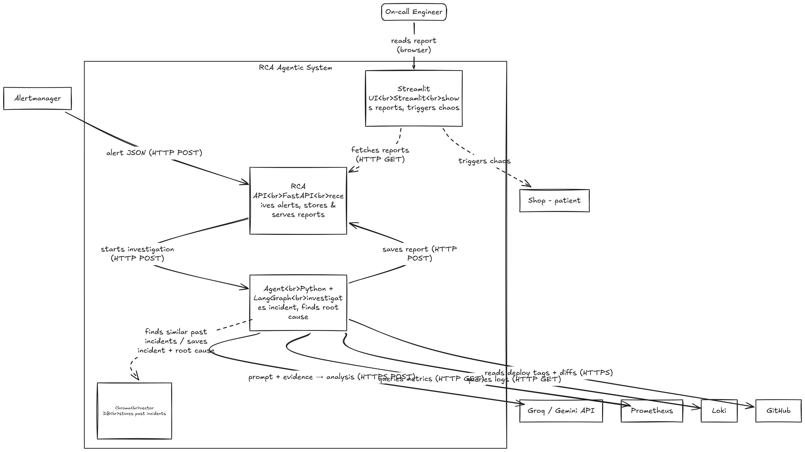

# Incident RCA Agent

**Break a live system, then watch a team of AI agents find out why — in seconds.**

A multi-agent root-cause analysis (RCA) system built with LangGraph. When an alert fires, specialist agents read logs, metrics and deploy history in parallel, a reasoning agent proposes the root cause, a critic agent checks it, and a report explains what broke and how to fix it.



> Demo video: coming soon

## The problem
When production breaks, an on-call engineer spends roughly 45–60 minutes jumping between dashboards, log searches and recent deploys before they even know *what* broke. Customers see errors the whole time.

This agent does that first investigation automatically: **median 4.6 s from alert to diagnosis, 91% top-1 accuracy on 11 real chaos incidents, ₹0 running cost** (free-tier LLMs).
It diagnoses; it does **not** auto-fix. A human stays in charge of the fix.

## How it works
1. **Patient:** a small shop (FastAPI + Postgres + Redis) with real traffic (Locust), monitored by Prometheus, Loki and Alertmanager, all in Docker Compose.
2. **Break it:** 12 chaos scripts kill, freeze or overload a component, or ship a bad deploy (a real git tag + rebuild).
3. **Alert:** Prometheus detects it; Alertmanager calls the agent's webhook (`POST /alerts`).
4. **Investigate:** a LangGraph pipeline runs:

| step | what it does | LLM? |
|---|---|---|
| Triage | which alerts fired, which stayed silent (silence is evidence) | no |
| Logs analyst | queries Loki, groups and names error patterns (never sends raw lines) | gpt-oss-20b |
| Metrics analyst | checks ~10 Prometheus signals with a z-score against a 10-min baseline | no (plain Python) |
| Deploy inspector → Code-diff reader | finds deploy tags just before the alert, reads the GitHub diff | diff only, gpt-oss-20b |
| Incident memory | finds similar past incidents in Chroma (vector search) | no |
| Root-cause reasoner | weighs all evidence, picks one cause from 12 labels, with confidence | gpt-oss-120b |
| Critic | checks the answer against the evidence; can send it back for a rethink | gpt-oss-120b |
| Reporter | writes a markdown report with the playbook fix | no |

Groq is the primary LLM provider, with an automatic fallback to Gemini. Every run is traced in Langfuse.



## Architecture


- `agent/api.py`: FastAPI. It receives the Alertmanager webhook (202 Accepted), de-duplicates by alert group, and runs the diagnosis in a background worker (one at a time, to respect free-tier limits). It streams per-agent progress through LangGraph's `stream()`. It also exposes guarded chaos endpoints for the demo: one outage at a time, a 10-min cooldown, and auto-restore.
- `ui/app.py`: a Streamlit dashboard that only talks to the API. It shows the live investigation timeline, the verdict and the evidence.

## Results
12 chaos scenarios: 5 **known** (the playbook was written from them), 2 **variants**, 5 **unseen**. 50 Locust users. **One run per scenario**; LLM answers can differ between runs. Full write-up: [`eval/results.md`](eval/results.md).

| metric | target | result |
|---|---|---|
| top-1 accuracy (scenarios that alerted) | ≥ 70% | **10/11 = 91%** (10/12 = 83% counting slow_query, which never alerted) |
| time to diagnosis (alert → report) | < 5 min | median **4.6 s**, max 7.2 s |
| LLM calls per incident | ≤ 15 | mean 3.45, max 4 |
| cost | ₹0 | ₹0 |
| deploy correctly named | – | 11/11 |

**Baselines on the same evidence:**

| | rules from the playbook | single LLM call | agent |
|---|---|---|---|
| known | 4/4 | 4/4 | 4/4 |
| variant | 0/2 | 1/2 | 2/2 |
| unseen | 0/5 | 4/5 | 4/5 |
| **all** | **36%** | **82%** | **91%** |

Hand-written rules only handle incidents someone has already seen. Most of the gain comes from the specialist agents turning raw telemetry into clean evidence; the critic loop added one more correct diagnosis (postgres_hang).

**Failure analysis drove two generic fixes** (v1 64% → final 91%):
- **Stale metrics:** a frozen database also freezes its exporter, so metrics showed it as "healthy". Fix: added exporter-health signals plus a rule that says those metrics are stale.
- **Missing logs:** an error message containing ids blew up Loki's label count. Fix: extract only the needed fields and normalise digits.

**Known limitations:**
- db_lock is still misdiagnosed (the lock also blocks the exporter).
- slow_query never fires an alert at 50 users.
- The fixes were found on the same test set, and the rerun covered 6 of 12 scenarios.
- The memory gain is not yet measured separately.

## Quick start (local)
Needs Docker Desktop (with WSL2 on Windows), Python 3.12+, and free API keys from Groq and Google AI Studio.

```bash
git clone https://github.com/Santo-15/incident-rca-agent.git && cd incident-rca-agent
cp .env.example .env                      # fill in GROQ_API_KEY, GOOGLE_API_KEY, passwords
docker volume create shop-pgdata          # first time only (the DB volume is external)
docker compose up -d                      # shop, Postgres, Redis, Locust, Prometheus, Loki, Alertmanager, Grafana
# first time only: create tables + base products, see shop/README.md ("Seed the database")

python -m venv .venv && source .venv/bin/activate
pip install -r agent/requirements.txt -r ui/requirements.txt
python -m agent.memory_seed               # builds the Chroma memory of past incidents

uvicorn agent.api:app --host 0.0.0.0 --port 8001   # terminal 1: the agent API
streamlit run ui/app.py                            # terminal 2: the dashboard → http://localhost:8501
```
Pick a failure in the sidebar, press **Break it**, and watch. Re-run the evaluation with `python -m eval.run_eval`; recompute the numbers offline with `python -m eval.metrics` and `python -m eval.baselines`.

## Tech stack and why
- **LangGraph:** explicit graph with a parallel fan-out, a join, and a critic loop. The state reducer (`operator.add`) lets parallel agents append findings safely.
- **Groq (gpt-oss-20b / 120b) + Gemini fallback:** fast and free; strict JSON-schema output so answers always parse. Fallbacks are logged, never hidden.
- **Prometheus, Loki, Alertmanager:** real observability tools, queried through their HTTP APIs behind adapter interfaces, so Datadog or ELK means adding one adapter.
- **Chroma:** a small vector store for past incidents; used as hints, never as proof.
- **FastAPI + Streamlit:** a webhook API with a background worker, plus a dashboard that only reads the API.
- **Langfuse:** a trace of every LLM call per incident.

## Repo layout
```
shop/           the patient: FastAPI shop-api
observability/  Prometheus, Loki, Alloy, Alertmanager, Grafana config
chaos/          12 failure scenarios (+ bad_deploy.sh)
agent/          LangGraph agent: graph.py, nodes/, tools/, prompts/, memory.py, api.py
ui/             Streamlit dashboard
eval/           ground truth, runner, results, metrics, baselines, results.md
docs/           playbook, manual RCA notes, diagrams, screenshots
```